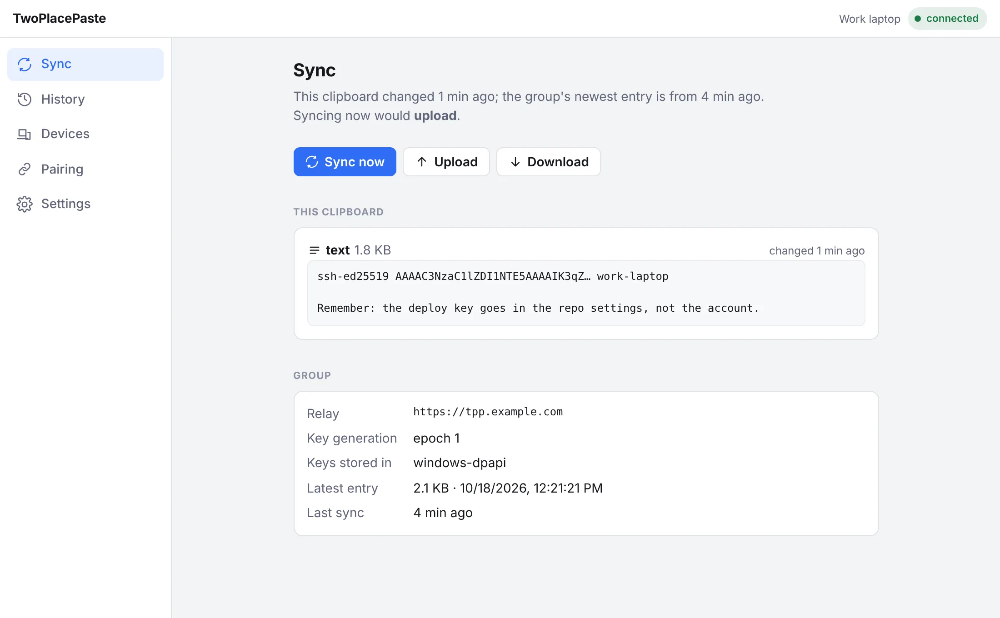

[](https://github.com/Mark7888/two-place-paste/actions/workflows/go.yml)
[](https://github.com/Mark7888/two-place-paste/actions/workflows/desktop.yml)
[](https://github.com/Mark7888/two-place-paste/actions/workflows/android.yml)
[](https://github.com/Mark7888/two-place-paste/actions/workflows/docs.yml)

# TwoPlacePaste

Share your clipboard across devices.

A self-hosted, end-to-end encrypted shared clipboard. Copy on one device, paste
on another. The server relays ciphertext and never sees clipboard content.

**📖 Documentation: [mark7888.github.io/two-place-paste](https://mark7888.github.io/two-place-paste/)**



## What you get

| Component | Stack | State |
|---|---|---|
| Relay server (`tpp`) | Go, Redis | Works. Relay, group/device registry, admin UI, blob GC. |
| Desktop app (`tppdesktop`) | Go + embedded React UI | Works on Windows and macOS. Tray icon, localhost web UI. |
| Go client core (`pkg/tppclient`) | Go | Works. All crypto and protocol; the desktop app is a shell around it. |
| Android app | React Native | In development. |

Each group of devices shares one key that the server only ever holds wrapped
to each device. Revoking a device rotates the key. Every entry expires after
24 hours. [How it works →](https://mark7888.github.io/two-place-paste/how-it-works/)

## Quick start

1. **Run the relay** with Docker Compose behind a TLS reverse proxy —
   [guide](https://mark7888.github.io/two-place-paste/self-hosting/docker/).
2. **Install the desktop app** —
   [Windows](https://mark7888.github.io/two-place-paste/install/windows/) ·
   [macOS](https://mark7888.github.io/two-place-paste/install/macos/):

   ```sh
   curl -fsSL https://github.com/Mark7888/two-place-paste/releases/latest/download/install-macos.sh | sh
   ```

3. **Create a group** with a link from the relay's admin page, then
   **add your other devices** —
   [guide](https://mark7888.github.io/two-place-paste/guides/create-a-group/).

## Development

```sh
make build test lint      # every Go module
make help                 # everything else
```

Setup, the desktop dev loop and the repository layout:
[Contributing](https://mark7888.github.io/two-place-paste/contributing/development/).
Design documents — specification, roadmap, conventions and feature plans — are
in [`docs/internal/`](docs/internal/). Read
[`docs/internal/conventions.md`](docs/internal/conventions.md) before your first PR.

The documentation site is in [`docs/site/`](docs/site/) (Starlight):
`cd docs/site && npm ci && npm run dev`.

## License

Copyright (C) 2026 Mark Licsauer

TwoPlacePaste is licensed under the [Mozilla Public License 2.0](LICENSE),
except the relay server in [`server/`](server/), which is licensed under the
[GNU Affero General Public License v3.0 or later](server/LICENSE). The
TwoPlacePaste name and logo are not covered by either license. See
[`LICENSING.md`](LICENSING.md) for the details and
[`CONTRIBUTING.md`](CONTRIBUTING.md) before opening a pull request.
